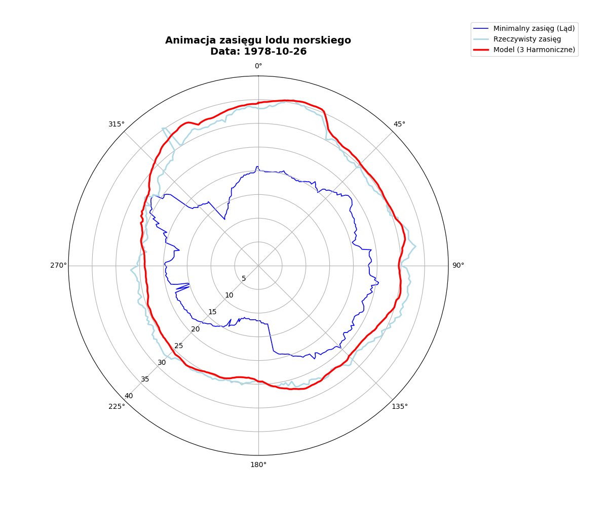

# Antarctic Sea Ice Extent Modeling — Harmonic Regression & Machine Learning

> Spatiotemporal mathematical modeling and machine learning forecasting of the Antarctic sea ice edge across **360° longitudinal sectors** (1970–1981 daily satellite observations) using **3-Harmonic Fourier Regression (OLS)** and **Random Forest**.

[-red?style=for-the-badge&logo=adobeacrobatreader)](./raport-modelowanie_krawedzi_lodu_antarktycznego.pdf)

---

## 🎯 Project Overview
Antarctic sea ice undergoes extreme seasonal fluctuations (ranging from approx. $2\text{ million}$ to $19\text{ million km}^2$ annually), playing a critical role in planetary albedo, heat balance, and polar ecosystem stability. 

This project develops an explicit analytical and machine learning framework to model daily sea ice edge dynamics across all **360 longitudinal meridians** (`longitude_0E` to `longitude_359E`), addressing two major physical challenges:
1. **Hard Environmental Boundary:** Extracting the true Antarctic continental coastline as a physical lower bound beyond which sea ice cannot retreat.
2. **Seasonal Asymmetry:** Capturing the rapid summer melting phase vs. the prolonged winter freezing period without overfitting daily satellite noise.

---

## 🎥 Spatiotemporal Ice Dynamics (Animation Preview)

  

---

## 🧮 Methodology & Mathematical Framework

### 1. Polar Coordinate Transformation & Coastline Extraction
Historical minimum ice extent values across the multi-year dataset represent the physical land/ice-shelf boundary of Antarctica. Standard geographic latitudes ($\text{Lat} \in [-90^\circ, 0^\circ]$) are transformed into polar radii centered at the South Pole ($r = 0$ at $90^\circ\text{S}$):

$$r(\theta) = \min_{t} \text{Latitude}(\theta, t) + 90^\circ$$

### 2. Analytical "Sweet Spot": 3-Harmonic OLS Regression
Because sea ice dynamics are driven by Earth's orbital periodicity ($\omega = 2\pi$), each longitudinal sector is modeled independently using Ordinary Least Squares (OLS) decomposed into a linear climate trend and three trigonometric harmonics:

$$f(t) = \text{Offset} + \text{Trend} \cdot t + \sum_{k=1}^{3} \left[ A_k \sin(2\pi k t) + C_k \cos(2\pi k t) \right]$$

* **$k = 1$ (Annual Cycle):** Captures the dominant seasonal oscillation (~$20^\circ$ latitude amplitude).
* **$k = 2$ (Semi-Annual Cycle):** Models the asymmetry between rapid summer retreat and gradual winter advance.
* **$k = 3$ (4-Month Cycle):** Resolves local seasonal inflection points while avoiding the overfitting observed at $k \ge 4$.

| Harmonic Model Order | Mean $R^2$ Score | Mean Absolute Error (MAE) | Root Mean Squared Error (RMSE) | Bias-Variance Assessment |
| :--- | :---: | :---: | :---: | :--- |
| **1st Harmonic (Annual)** | `0.7610` | — | — | Underfits seasonal asymmetry |
| **2nd Harmonic (Semi-Annual)** | `0.8120` | — | — | Captures basic asymmetry |
| **3rd Harmonic (Optimal)** | **`0.8226`** | **`0.862°`** | **`1.156°`** | **Optimal analytical balance** |
| **4th Harmonic (Quarterly)** | `0.8150` | — | — | Overfitting / generalization drop |

---

### 3. Machine Learning Benchmark: Random Forest Regressor
To capture non-linear interactions between geographic longitude and seasonal cycles, a **Random Forest Regressor** was trained and validated using an 80/20 train-test split:

| Model Architecture | $R^2$ Score | Key Takeaway |
| :--- | :---: | :--- |
| **Baseline Linear Regression (No Seasonality)** | `0.0209` | Fails to capture cyclical climate dynamics |
| **Linear Regression + Seasonality (`Month`)** | `0.3094` | Rigid linear assumption insufficient for polar geometry |
| **Random Forest (Training Set)** | `0.9918` | High capacity for non-linear spatial-temporal mapping |
| **Random Forest (Test Set — 20% Holdout)** | **`0.9546`** | Strong generalization on unseen satellite observations |

**Feature Importance Analysis (Random Forest):**
* **Seasonality (`Month`):** `47.86%`
* **Geography (`Longitude`):** `42.47%`
* **Long-Term Linear Trend (`Date_numeric`):** `9.67%`
> *Conclusion:* Seasonal cycles and continental geometry govern over **90%** of Antarctic sea ice edge variability.

---

## 📂 Repository Structure

* 📄 **[`raport-modelowanie_krawedzi_lodu_antarktycznego.pdf`](./raport-modelowanie_krawedzi_lodu_antarktycznego.pdf)** — Full project presentation slide deck with methodology, time-series plots, and validation metrics.
* 🧭 **[`01_linia_brzegowa_polar.py`](./01_linia_brzegowa_polar.py)** — Extracts minimum ice extent per meridian and renders the Antarctic coastline in polar coordinates.
* 📈 **[`02_model_3_harmoniczny.py`](./02_model_3_harmoniczny.py)** — Vectorized 3-harmonic OLS solver across 360 sectors; exports mathematical parameters to CSV[cite: 118].
* 🎬 **[`animation.gif`](./animation.gif)** — Dynamic spatiotemporal animation comparing raw satellite data against the 3-harmonic model[cite: 118].
* 📊 **[`daily_ice_edge.csv`](./daily_ice_edge.csv)** — Input dataset containing daily satellite latitude measurements across 360° longitudes[cite: 118].

---

## 👥 Authors
* **Mateusz Grodzki**
* **Kamila Bodziony**
* **Kamila Dziewa**
